  

## Hi, I'm Ömer Faruk

I'm a Senior Data Analyst in Istanbul. I turn sales, returns, inventory, and operations data from e-commerce brands into KPI dashboards that teams use every day. I work in SQL Server, MongoDB, and Tableau, and I'm now moving toward data engineering: building the pipelines that feed those dashboards.

**Interactive version of this CV:** [engofs0120.github.io](https://engofs0120.github.io)

---

## My stack, laid out as a pipeline

| Ingest | Transform | Store | Serve |
|---|---|---|---|
| SSIS ETL processes | T-SQL | Microsoft SQL Server | Tableau Desktop and Cloud |
| Live brand-period syncs | MongoDB aggregation pipelines | MySQL | Power BI |
| | Tableau Prep | MongoDB | Owl, an internal KPI application |
| | Power Query and DAX | Materialized views | Excel exports |

**Validate:** data reconciliation, KPI validation, root-cause analysis
**AI-assisted workflows:** Cursor, MCP-connected tools, Gemini KPI assistant, Claude Code

---

## Experience

<b>RND E-commerce Fulfillment</b>, Senior Data Analyst (Jan 2025 to present)

 

- Build daily, weekly, monthly, and yearly marketplace and e-commerce KPI dashboards for global and local brands, including The North Face, Vans, Timberland, Calvin Klein, Guess, Pandora, Benetton, Levi's, and Tommy Hilfiger.
- Extract, transform, and visualize data with MSSQL, MongoDB, Tableau Desktop, Tableau Cloud, and Tableau Prep. Automated dashboards cover sales, conversion, and operational KPIs.
- Design interactive Tableau reports for marketing and management teams, and build backoffice reports from MSSQL queries embedded in XML.
- Develop MongoDB reports for sales and returns using aggregation pipelines and materialized views.
- Extend **Owl**, RND's internal KPI application that consolidates brand-level sales, returns, inventory, traffic, and customer-service data from multiple systems:
  - Aligned return-acceptance and delivery-time calculations with e-commerce figures.
  - Added order, unit, and sales-value columns and increase/decrease indicators to the city, division, season, and Top 10 returns tables.
  - Added account-level brand access, Turkish and English interface support, and downloadable Excel exports.
  - Ran live brand-period syncs and verified invoice and quantity fields.
- Use Cursor agents and MCP-connected tools for data exploration, query development, and root-cause analysis. Use the Gemini KPI assistant to query report figures in natural language, and fixed a stalled Gemini translation flow.

<b>Freelance</b> (Jun 2023 to present) and <b>KVK Teknoloji Ürünleri</b>, Senior Data Analyst (Jan 2024 to Dec 2024)

 

- Senior Data Analyst work on freelance analytics projects since June 2023, and at KVK Teknoloji Ürünleri from January to December 2024.

<b>Koton</b>, Senior Data Analyst (Apr 2021 to Apr 2023)

 

- Developed dynamic dashboards and complex SQL queries for data-driven decision-making.
- Built analytical reports, dashboards, and visualizations as BI solutions.
- Automated daily, weekly, and monthly reporting with Power Pivot, DAX, Power Query, and XLOOKUP.
- Designed Power BI reports for senior management.
- Designed SSIS ETL processes to extract, transform, and load data from multiple sources.

<b>KVK Teknoloji Ürünleri</b>, Reporting and Data Analyst Specialist (Mar 2019 to Apr 2021)

 

- Monitored and analyzed service metrics, including repair durations, parts replacement rates, and customer satisfaction scores.
- Built KPI reports on technical service performance and presented them to senior management.
- Ran Turnaround Time (TAT) analyses with technical teams to find ways to speed up repairs.
- Extracted and analyzed database insights with SQL.

<b>UFS Center E-Commerce Company</b>, Founder (Sep 2017 to Mar 2019)

 

- Ran multi-channel sales on Trendyol, Hepsiburada, N11, and Amazon.
- Coordinated supply chain, inventory, and logistics, and handled customer relationships and after-sales support.
- Analyzed and optimized marketplace performance, product listings, content, and digital marketing.

<b>Sigorta Bilgi ve Gözetim Merkezi</b>, HR Data Analyst (May 2016 to Sep 2017)

 

- Analyzed HR data on employee performance, turnover, and recruitment to support strategic decisions.
- Organized the transition to the SAP HR module.
- Designed employee performance-tracking dashboards with Excel and Power Pivot.

---

## Next: Data Engineer

<b>What I already bring to the role</b>

 

- ETL design with SSIS
- MongoDB aggregation pipelines and materialized views
- T-SQL and query development across SQL Server and MySQL
- Data reconciliation and root-cause analysis on production reporting
- Certification: Google Cloud, Introduction to Data Engineering

---

## Education

Pamukkale University, Industrial Engineering (2014)

## Find me

[LinkedIn](https://www.linkedin.com/in/%C3%B6mer-faruk-%C5%9Fahin-822526138) · [GitHub](https://github.com/engofs0120)
